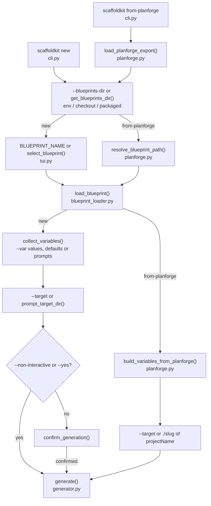
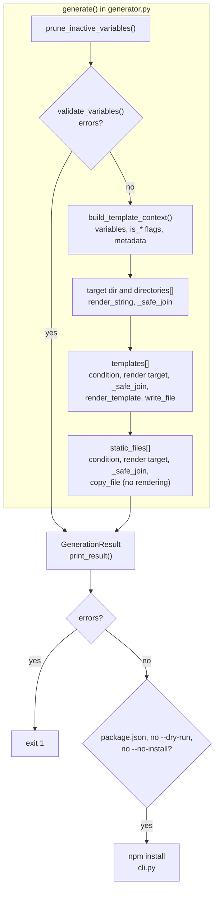

# Architecture

ScaffoldKit is three layers stacked top to bottom: a Typer CLI / questionary TUI on top (with the CLI-side helpers `planforge.py` and `scaffold_blueprint.py` below it), a generation engine in the middle, and a YAML/Pydantic blueprint layer at the bottom. The engine is pure Python with no daemons, no remote services, and no shared state across runs.

## Layer diagram

```
┌─────────────────────────────────┐
│  TUI / CLI Layer                │  Interactive prompts, display
│  (cli.py, tui.py)               │
├─────────────────────────────────┤
│  CLI helpers                    │  planforge import, init-blueprint
│  (planforge.py,                 │
│   scaffold_blueprint.py)        │
├─────────────────────────────────┤
│  Generator / Rendering Layer    │  Template rendering, file I/O
│  (generator.py, renderer.py,    │
│   filesystem.py)                │
├─────────────────────────────────┤
│  Blueprint / Data Layer         │  Models, loading, validation,
│  (models.py,                    │  conditional variables
│   blueprint_loader.py,          │
│   validators.py,                │
│   variable_conditions.py)       │
└─────────────────────────────────┘
```

## Module map

| Module | Responsibility |
|--------|----------------|
| `cli.py` | Typer entry point. Owns the four subcommands (`new`, `from-planforge`, `init-blueprint`, `list`) and the post-generate `npm install` hook. |
| `tui.py` | Interactive prompts (questionary + Rich). Blueprint picker, variable collection, target-dir prompt, confirmation summary, post-generate result printer. |
| `generator.py` | Orchestrates a generation run: prunes inactive variables, validates the rest, builds the Jinja context (including derived `is_*` flags), creates declared directories, iterates templates and static files, returns a `GenerationResult`. |
| `renderer.py` | Wraps Jinja2: env construction, string rendering for inline values, template rendering from disk, raises with file context on missing variables. |
| `filesystem.py` | All file I/O: `ensure_directory`, `write_file`, `copy_file`; honours `overwrite`. Dry-run is handled in `generator.py`, which skips these calls. |
| `models.py` | Pydantic models: `Blueprint`, `BlueprintVariable`, `VariableType`, `GenerationContext`, `GenerationResult`. |
| `blueprint_loader.py` | Discovery and parsing. Resolves the blueprints directory (env override -> local checkout -> packaged), parses `blueprint.yaml`, validates against the model. |
| `validators.py` | Variable validation: required fields, type checks, choice membership. |
| `variable_conditions.py` | Prunes variables whose `condition` parent is falsy after collection. |
| `planforge.py` | `scaffoldkit-input.json` schema (`PlanforgeExport`), variable mapping, inference rules, blueprint-candidate fallback. See [planforge-integration.md](planforge-integration.md). |
| `scaffold_blueprint.py` | Backs `init-blueprint`: writes a starter `blueprint.yaml`, `templates/`, and `static/` skeleton. |

## Generation pipeline

`scaffoldkit new` (variables from the TUI or `--var` flags) and `scaffoldkit from-planforge` (variables from a planforge export) share the same `generate()` pipeline. They differ in how the blueprint, the variables and the target directory are chosen.

This diagram shows how each command gets from its arguments to a `generate()` call:



This diagram shows what `generate()` does and what the CLI does with its result:



1. **Resolve blueprints dir.** `--blueprints-dir` wins, then the `SCAFFOLDKIT_BLUEPRINTS_DIR` env var. Otherwise the loader walks up from `cwd` looking for a `pyproject.toml` plus `src/scaffoldkit/blueprints/` (so editing inside a checkout just works). Falls back to the packaged blueprints shipped with the wheel.
2. **Load blueprint.** Parse `blueprint.yaml`, validate against the `Blueprint` model. `from-planforge` first picks the blueprint from the export's candidates (see [planforge-integration.md](planforge-integration.md)).
3. **Collect variables.** For `new`, either via the TUI prompts or by merging `--var` flags with blueprint defaults under `--non-interactive`; required variables without defaults still fail fast. For `from-planforge`, the variables are mapped from the export.
4. **Prune.** `variable_conditions.prune_inactive_variables` drops variables whose `condition` parent is now falsy.
5. **Validate.** `validators.py` checks required-ness, value types, and choice membership.
6. **Build template context.** `generator.build_template_context` adds the variables, the blueprint identity fields (`blueprint_name`, `blueprint_display_name`, `blueprint_stack`), and a fixed set of derived `is_*` flags so templates can branch on language, framework, package manager, config format, build tool, stack, API style, test runner and static-site options without restating the same string compares. The blueprint's `metadata` map is merged last. See [Conditions and derived flags](blueprints.md#conditions-and-derived-flags) for the full list.
7. **Create directories.** The target directory and each `directories[]` entry (rendered through Jinja) are created under the target.
8. **Render templates.** Each `templates[]` entry is rendered through Jinja2; the optional `condition` field skips entries whose condition key is missing or falsy in the template context. The `target` path is itself Jinja-rendered, so output paths can depend on variables. The `source` path is used literally, relative to `templates/`; to vary the source by stack, declare one entry per variant and gate each with `condition`.
9. **Copy static files.** Each `static_files[]` entry whose `condition` holds is copied verbatim from `static/` to its `target`. Only the `target` path is rendered; the file content is not.
10. **Post-generate hook.** Only when generation reported no errors: if the generated tree has a `package.json` and neither `--no-install` nor `--dry-run` was passed, `cli.py` runs `npm install` in the target directory. Missing `npm` is a warning, not a failure. Generation errors exit with status 1 instead.

Every rendered directory and file target in steps 7-9 goes through the path-containment check described below.

With `--dry-run`, steps 7-9 compute and print paths without creating directories or writing files (templates are still rendered), and step 10 is skipped.

## Watch and incremental?

There isn't one. Generation is a one-shot operation. There is no daemon, no incremental rebuild, and no shared state between runs. Re-running into the same target directory requires `--overwrite`.

## Path containment

Rendered target paths come from untrusted sources (user `--var` input and third-party blueprints), so every generated file and directory is routed through `generator._safe_join`. It resolves the rendered path against the target directory and raises if the result escapes it, refusing absolute paths and `..` traversal. An unsafe entry is recorded as a generation error and skipped rather than written outside the target tree.

The guard controls only where files are written. It does not make a third-party blueprint safe to run:

- Templates and target strings render in a standard, unsandboxed Jinja2 environment, so template code runs with the permissions of the scaffoldkit process. This also happens under `--dry-run`, which skips only the writes.
- `static_files` sources are joined onto `static/` without a containment check, so a blueprint can copy other readable files from the host into the generated project.
- When the output contains a `package.json`, `scaffoldkit new` and `scaffoldkit from-planforge` run `npm install`, which executes that package's lifecycle scripts.

Review a blueprint before you run it, and pass `--no-install` for one you have not reviewed.

## Design principles

- **Declarative over hard-coded.** Blueprints are YAML, templates are Jinja2. Adding a stack is adding a folder, not editing the engine.
- **Extensible over perfect.** The model is intentionally flat (no nested variables, no remote registry). New blueprints land as folders; new shipped blueprints are committed to `src/scaffoldkit/blueprints/`.
- **Locally runnable.** No external services required. `from-planforge` reads a local file. Embeddings, networks, and daemons are out of scope.
- **AI-friendly by design.** Every blueprint ships an architecture doc and an ADR seed and, unless `ai_context` is false, agent context files (`AI_CONTEXT.md`; `express-api` ships an `.ai/` tree instead). All blueprints except `express-api` also ship ways-of-working notes. A downstream Claude Code or Cursor session has real grounding from the first turn.

## Technologies

| Component | Technology |
|-----------|-----------|
| Language | Python 3.11+ |
| CLI | [Typer](https://typer.tiangolo.com/) |
| TUI Prompts | [questionary](https://github.com/tmbo/questionary) + [Rich](https://rich.readthedocs.io/) |
| Templating | [Jinja2](https://jinja.palletsprojects.com/) |
| YAML | [PyYAML](https://pyyaml.org/) |
| Models | [Pydantic](https://docs.pydantic.dev/) v2 |
| Packaging | [Hatch](https://hatch.pypa.io/) + [uv](https://docs.astral.sh/uv/) |
| Container | Docker (optional) |

## Repository layout

```
scaffoldkit/
├── install.sh                # One-line installer (uv or Docker)
├── Makefile                  # Build, test, install shortcuts
├── Dockerfile                # Container build
├── scaffoldkit-docker        # Docker wrapper script (not installed by install.sh)
├── docker-compose.yml        # scaffoldkit service, ./output mounted at /workspace
├── pyproject.toml
├── src/
│   └── scaffoldkit/
│       ├── cli.py
│       ├── tui.py
│       ├── generator.py
│       ├── blueprint_loader.py
│       ├── renderer.py
│       ├── filesystem.py
│       ├── models.py
│       ├── validators.py
│       ├── variable_conditions.py
│       ├── planforge.py
│       ├── scaffold_blueprint.py
│       └── blueprints/        # 12 shipped blueprints
├── tests/                     # pytest suite: engine modules, CLI, TUI, planforge, notify script, per-blueprint and contract-audit tests
├── docs/                      # architecture, blueprints, CLI and planforge reference
├── scripts/
│   └── notify-planforge.sh    # files an agent-planforge bump task on master push
├── .github/workflows/
│   ├── ci.yml                 # lint, shellcheck, mypy strict, pytest 3.11/3.12/3.13 with coverage floor, build+install
│   ├── notify-planforge.yml   # runs scripts/notify-planforge.sh on push to master
│   └── release.yml            # on v* tags: rerun CI, check version and changelog, publish a GitHub Release
├── CONTRIBUTING.md
├── CHANGELOG.md
├── SECURITY.md
└── LICENSE
```

## Test suite

The pytest suite covers:

- **Models.** Data model construction and validation.
- **Blueprint loading.** Discovery, parsing, error handling.
- **Validators.** Required fields, type checks, choice validation.
- **Renderer.** String rendering, template rendering, missing-variable errors.
- **Filesystem.** Directory creation, file writing, copy, overwrite protection.
- **Generator.** Full pipeline, dry-run, conditions, overwrite, static files.
- **Variable conditions.** Activation and pruning of conditional variables.
- **CLI.** Command help, blueprint listing, error paths.
- **TUI.** Non-interactive variable collection.
- **Planforge.** Export loading, variable mapping and inference helpers.
- **init-blueprint.** The starter blueprint written by `scaffold_blueprint.py`.
- **Notify script.** A dry run of `scripts/notify-planforge.sh`.
- **Per-blueprint tests.** Generation and starter-file checks for the shipped blueprints (`test_*_starter.py`, `test_*_blueprint*.py` and similar).
- **Blueprint contract audit.** Every declared variable is referenced by a template or static file or used as a `condition`, `use_docker`/`use_ci` gate matching files, runnable blueprints declare their primary manifests, and generated workflows pin the expected action majors.
- **Integration.** End-to-end generation across stack/style/feature variations.

CI runs ruff lint and format checks, shellcheck on `scripts/*.sh`, mypy strict, pytest on Python 3.11, 3.12 and 3.13 with the coverage floor set in `ci.yml`, and a build and install check on every push and pull request to `master`.

## Assumptions and limits

- Python 3.11+ on the host (or via the `./install.sh` uv path, or via Docker).
- Blueprints live alongside the source code. There is no remote registry yet.
- Single-user local execution. No concurrency handling.
- Blueprint variables are flat. Nested objects are not supported.
