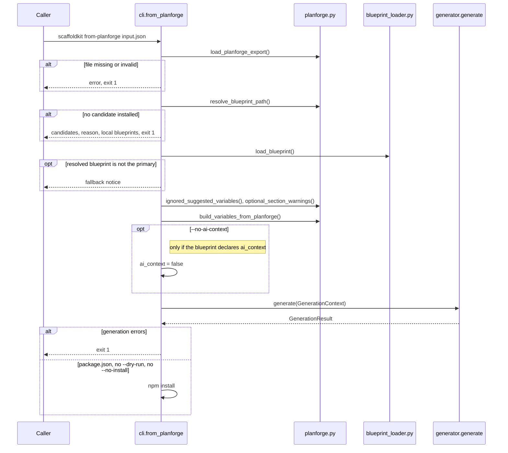

# Planforge integration

[agent-planforge](https://github.com/LanNguyenSi/agent-planforge) is a planning tool that turns a project brief into a `scaffoldkit-input.json` export. `scaffoldkit from-planforge` consumes that file and generates a project without re-prompting for variables planforge already decided.

## Usage

```bash
scaffoldkit from-planforge ./scaffoldkit-input.json --target ./my-project
```

Same flags as `scaffoldkit new` except for `--var` / `--non-interactive` / `--yes`: planforge supplies those values. The supported flags are `--target`, `--dry-run`, `--overwrite`, `--no-install`, `--blueprints-dir`, and `--no-ai-context`. The last is specific to `from-planforge`: it suppresses the blueprint's AI-context files (the `.ai/` tree and `AI_CONTEXT.md`), which is useful when the caller already owns its own agent context, e.g. the agent-planforge container whose `.ai/` would otherwise be clobbered by `--overwrite`.

The resolver builds an ordered candidate list (an inferred framework blueprint, see [Generic API fallback](#generic-api-fallback), then `blueprint`, then `blueprintCandidates`) and uses the first one installed, printing a notice when that is not `blueprint`. If none is installed, you get the candidate list plus the locally available blueprints in the error output.

### Flow

`from-planforge` runs these steps in order:



Without `--target`, the project is generated into `./<slug of projectName>` under the current directory.

## `scaffoldkit-input.json` schema

The export is validated against `PlanforgeExport` (see `src/scaffoldkit/planforge.py`):

```json
{
  "version": "1.0",
  "exportedBy": "agent-planforge",
  "projectName": "Acme Billing API",
  "summary": "Internal billing service for invoices and subscriptions.",
  "blueprint": "fastapi-backend",
  "blueprintCandidates": ["rest-api"],
  "blueprintReason": "Python ecosystem, OpenAPI required.",
  "plannerProfile": "backend-service",
  "architecture": {
    "shape": "layered service with workers",
    "optionId": "layered-v1",
    "phase": "mvp",
    "path": "monolith"
  },
  "stack": {
    "hint": "FastAPI + Postgres + Redis",
    "dataStore": "postgresql",
    "integrations": ["stripe", "sendgrid"]
  },
  "features": ["billing", "invoices", "background jobs"],
  "constraints": ["docker", "openapi"],
  "suggestedVariables": {
    "use_docker": true,
    "use_redis": true,
    "auth_strategy": "jwt"
  }
}
```

| Field | Required | Notes |
|-------|----------|-------|
| `projectName` | yes | Source for `project_name` (slugified) and `display_name`. |
| `blueprint` | yes | Primary blueprint candidate. |
| `version` | no | Free-form. Currently unused. |
| `exportedBy` | no | Free-form. |
| `summary` | no | Drives the inferred `description` and several signal regexes. |
| `blueprintCandidates` | no | Ordered fallbacks if `blueprint` is not installed. |
| `blueprintReason` | no | Surfaced in the error output if no candidate resolves. |
| `plannerProfile` | no | Free-form planner identifier. |
| `architecture.shape` | no | Free-form architecture description, mined for signals. |
| `architecture.optionId` / `phase` / `path` | no | Free-form passthroughs. |
| `stack.hint` | no | Free-form stack description, mined for `language` / `framework` signals. |
| `stack.dataStore` | no | Used for database inference, defaults to `relational`. |
| `stack.integrations` | no | Free-form list of integration tags. |
| `features` | no | Free-form list, mined for queue/notification/realtime signals. |
| `constraints` | no | Free-form list, mined for docker/api-key signals. |
| `suggestedVariables` | no | Direct map onto blueprint variables. Unsupported keys are ignored with a warning. |

Empty `summary`, `features`, `constraints`, or `architecture.shape` print a warning explaining which inference paths fall back to blueprint defaults.

## Variable mapping

`from-planforge` populates blueprint variables in this order:

1. Start with the blueprint's declared defaults.
2. Set `project_name` to a slug of `projectName`. Set `display_name` to `projectName`. Set `description` to `summary`; if `summary` is empty, keep the blueprint's default description, and use `projectName` only when the blueprint declares none.
3. Set `ai_context = true` if the blueprint has that variable.
4. Apply every key in `suggestedVariables` that maps to a real blueprint variable. Unsupported keys are listed in a warning.
5. For variables planforge did not set (and the blueprint default is unchanged), apply the inference rules below.
6. Normalise everything through the blueprint's type contract: booleans accept `true`/`yes`/`1`, choices clamp to declared options or fall back to the default.
7. Prune variables whose `condition` parent is now falsy.

### Inference rules

Unless a row says otherwise, the combined text of `projectName`, `summary`, `features`, `constraints`, `architecture.shape`, and `stack.hint` is searched for keywords. Inferred values outside a blueprint's declared choices fall back to its default (step 6).

| Variable | Trigger |
|----------|---------|
| `use_docker` | `docker`, `container`, `kubernetes`, `compose`. |
| `language` | `typescript` -> `typescript`, `\bgo\b` -> `go`, `rust` -> `rust`, otherwise `python`. |
| `cli_framework` | Derived from `language`: python -> `typer`, go -> `cobra`, rust -> `clap`, typescript -> `commander`. |
| `distribution` | `go`, `rust` and `typescript` get `binary`, otherwise `pip-package`. |
| `test_strategy` | `git`/`sync`/`filesystem`/`queue`/`workflow`/`remote` -> `integration-tests`, otherwise `unit-tests`. Blueprint-specific overrides for `fastapi-backend` and `django-drf`. |
| `use_analytics` | `analytics`/`dashboard`/`report`. |
| `use_email` | `email`/`notification`/`invite`. |
| `use_queue` | `background jobs`/`queue`/`workflow`/`notification`. |
| `use_auth` | Forced `false` when `public-only`/`anonymous`/`no auth` appears. |
| `use_openapi` | Default `true`. |
| `db_provider` / `database` | Searches `stack.dataStore`, `constraints`, `features` and `summary`: `sqlite` or `mysql` select that choice, `mongo` selects `mongodb` (for `database` only), otherwise `postgresql`. |
| `framework` | `express` when `stack.hint` contains `typescript` (any of agent-planforge's TypeScript hints: service stack, CLI tool, web application), otherwise `fastapi`. |
| `auth_strategy` | Searches `summary`, `features` and `constraints`: `public-only`/`anonymous` -> `none`, `api key`/`api-key` -> `api-key` (`token` for django-drf), `session` -> `session` (django-drf only), `oauth2` -> `oauth2`, `sso`/`next-auth` -> `next-auth` (nextjs-fullstack only), otherwise `jwt`. |

Blueprint-specific extras live alongside these rules. See `src/scaffoldkit/planforge.py` for the canonical implementation.

### Generic API fallback

If `rest-api` is the primary blueprint or one of the candidates and the export text (`projectName`, `summary`, `features`, `constraints`, `architecture.shape`, `stack.hint`, `stack.dataStore`) mentions Django, DRF, serializer, viewset or admin, the resolver puts `django-drf` first; otherwise, if it mentions FastAPI, Pydantic, uvicorn, ASGI or Python, it puts `fastapi-backend` first. The inferred blueprint is used even when `rest-api` is installed; the CLI then prints "Using inferred blueprint ... instead of primary ...", and when the primary blueprint is not installed at all it prints "Primary blueprint ... is not installed; using fallback ... instead". This keeps planforge from having to know every Python web framework upfront.

## Producing a `scaffoldkit-input.json`

agent-planforge owns the export contract. Its CLI (`node scripts/bootstrap-plan.js --input <file> --outdir <dir>`) writes the file to `<dir>/exports/scaffoldkit-input.json`; its HTTP service reads the same path and can run `scaffoldkit from-planforge` on it. See agent-planforge's [operational workflow](https://github.com/LanNguyenSi/agent-planforge/blob/main/docs/operational-workflow.md). Point `scaffoldkit from-planforge` at that file.

## Notifying agent-planforge of new commits

The relationship also runs in the other direction: agent-planforge's `server/Dockerfile` pins ScaffoldKit to a fixed commit SHA (`SCAFFOLDKIT_REF`). Every merge to `master` here auto-opens a `chore(deps): bump scaffoldkit to <sha7>` task in agent-planforge's agent-tasks project (see `.github/workflows/notify-planforge.yml` and `scripts/notify-planforge.sh`). This keeps the drift between ScaffoldKit's default branch and the pinned SHA visible instead of silent; the task carries the compare URL, the changed files, and a re-pickup checklist for whoever bumps the pin.

**Documentation-only pushes are skipped.** When every file changed by the push is documentation (root-level `*.md`, anything under `docs/`, `LICENSE`, `.github/pull_request_template.md` or `.github/ISSUE_TEMPLATE/`), the script logs a `::notice::` and opens no task, because such a push cannot change what agent-planforge pins. A Markdown file elsewhere (for example a blueprint template's `README.md` under `src/`), any script change (including comment-only edits), a rename that touches a non-documentation path, a push with no changed files and the first push to a branch always open the task.

**Provisioning the notification.** The workflow no-ops (green, with a visible `::notice::`) until the operator provisions the bot token:

```bash
gh secret set PLANFORGE_BOT_TOKEN --repo LanNguyenSi/scaffoldkit
```

The token needs `tasks:create` scope to open the bump task, and `tasks:update` scope to supersede an older open bump task when a newer commit lands before the previous one was picked up. The bot identity also needs membership on agent-planforge's agent-tasks project: project access is enforced independently of token scopes, so a correctly-scoped bot that isn't a project member gets a 403 "No project access" on the very first call and the workflow goes red.

Supersede is best-effort. An older open bump task that the bot itself created is closed (status `abandoned`) through `POST /api/tasks/:id/creator-abandon`, with `Superseded by <sha7>` as the reason (recorded in the task's audit log). If the older task was filed by a human or a different identity, or the abandon call is rejected, the script falls back to respeccing its description with the `Superseded by` note (which succeeds only for the creator unless the project allows non-creator respec, `allowNonCreatorRespec`) and logs a warning. None of these failures fail the workflow; the new task is created regardless.

Optional: export `PLANFORGE_BOT_AGENT_ID` (the bot token's agent-token id) in the script's environment; `.github/workflows/notify-planforge.yml` does not pass it today. The script then skips the abandon attempt for tasks created by any other agent instead of letting the backend reject it (a harmless 403 warning per older task). agent-tasks has no whoami route for agent tokens; the id appears as `createdByAgentId` on a bump task the bot filed.

After provisioning the token and project access, verify the first push to `master` shows a green "Notify Planforge" run in Actions.
